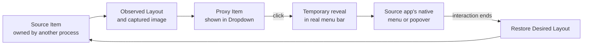

# Technical feasibility

Status: research conclusion and prototype plan; not an implementation specification.

## Executive conclusion

The app is plausible as a **proxy Dropdown with native interaction handoff**, pending the prototype gates below. It is not feasible as a literal second macOS status bar using only supported AppKit APIs.

`NSStatusBar` and `NSStatusItem` let an application create and manage its own items. Their documented API has no operation to enumerate, adopt, reparent, or render another process's status item inside a custom panel. This “no cross-process adoption API” statement is an inference from the public API surface, not a sentence Apple explicitly publishes.

The smallest credible design therefore combines:

- the app's own `NSStatusItem` for the Launcher and a boundary it controls;
- macOS Accessibility to expose cross-process metadata and supported actions;
- window geometry plus synthesized pointer/Command-drag events to perform movement that Accessibility does not expose as a reorder operation;
- captured images for Proxy Items where the source application does not provide a usable image;
- a temporary real-menu-bar position for native interaction;
- potentially undocumented/private WindowServer calls if public inventory, ownership attribution, geometry, and off-screen capture prove insufficient;
- SwiftUI for Settings and Dropdown content, with small AppKit bridges for status-item, panel, application-lifecycle, and event behavior.

This is significantly more complex than Hidden Bar's hiding trick. The user interface can remain very small, but the engine must handle cross-process geometry, permissions, identity, input, restoration, and OS differences.

## Why literal embedding is not available

A Source Item is owned by its source process and coordinated by macOS. A SwiftUI view can imitate its current pixels, but it cannot acquire the original target/action, menu, popover anchor, accessibility tree, internal state, or process ownership.

Consequences:

- The Dropdown contains Proxy Items, not Source Items.
- A Proxy Item cannot independently reproduce every native behavior.
- Preserving native behavior requires handing interaction back to the real Source Item.
- The source app's menu or popover is anchored to a temporary real-menu-bar location, not truly to the Proxy Item. This trade-off is accepted: TrayNook places the Source Item near the Launcher when macOS allows, but never reimplements the foreign interface merely to make it appear beneath the proxy. See [ADR 0007](adr/0007-use-proxies-and-native-interaction-handoff.md).

The design should communicate this honestly while keeping the user-facing action simple: “Move to Dropdown.”

## Evidence from existing projects

### Hidden Bar

[Hidden Bar](https://github.com/dwarvesf/hidden) is a compact MIT-licensed utility. Its [architecture notes](https://github.com/dwarvesf/hidden/blob/develop/docs/ARCHITECTURE.md) explain the core technique: status items that the app owns create a boundary, and changing one item's length pushes other items out of the visible region. macOS still owns the other items.

That design is small and restores naturally when its own boundary disappears, but it cannot itself expose items concealed by the notch. Hidden Bar's open work on a separate bar illustrates the additional requirements:

- [PR #350](https://github.com/dwarvesf/hidden/pull/350) experiments with Accessibility discovery and press actions.
- [PR #358](https://github.com/dwarvesf/hidden/pull/358) experiments with captured proxies and forwarded clicks, requiring Accessibility and Screen Recording.
- [Issue #366](https://github.com/dwarvesf/hidden/issues/366) records the lack of a supported API for arbitrary cross-app ordering and explores a managed overflow model.

### Ice and related utilities

[Ice](https://github.com/jordanbaird/Ice) already implements a feature-rich separate bar. Its public source demonstrates a workable handoff pattern: display captured representations, temporarily move the real item to a usable menu-bar position, synthesize the click, keep the real item available while the source interface is open, and restore it afterward. In the examined revision, the [Ice Bar click path](https://github.com/jordanbaird/Ice/blob/11edd39115f3f43a83ae114b5348df6a0e1741cf/Ice/UI/IceBar/IceBar.swift) closes the proxy panel before handoff, and its [private bridge](https://github.com/jordanbaird/Ice/blob/11edd39115f3f43a83ae114b5348df6a0e1741cf/Ice/Bridging/Shims/Private.swift) declares undocumented CGS functions.

The pattern is proof of possibility, not an API guarantee. It relies on Accessibility, synthetic events, WindowServer geometry, and screen capture behavior that Apple can change. Ice is GPL-3.0, so code cannot be copied into a permissively licensed project without adopting compatible GPL terms.

Commercial and open-source competitors that advertise a second bar or panel generally have substantially broader scope. Their existence reduces product risk but does not remove the platform-maintenance risk.

### Barbee

Barbee is proprietary, so its implementation cannot be audited. Its [current official layout screenshot](https://is1-ssl.mzstatic.com/image/thumb/PurpleSource211/v4/64/5a/81/645a8160-7465-c981-2205-732bf49e2616/2.png/1286x804bb.webp) directly confirms a draggable Shown/Hidden/Always Hidden lane editor. In a [public developer discussion](https://www.reddit.com/r/macapps/comments/1cku4ai), the author explained that Enhanced mode's extra-bar items are screen-captured, require Accessibility and Screen Recording, and cause real menu-bar icons to be rearranged for use. This is behavioral evidence for the same proxy-and-handoff family, not source evidence about current Barbee internals.

The full comparison and confidence labels are in [Reference analysis](REFERENCE_ANALYSIS.md).

## Proposed mechanism

### 1. Inventory

Build an in-memory Observed Layout of menu-bar windows and their accessibility elements. Associate each candidate at runtime with source process identity, bundle identifier, accessibility metadata, geometry, and an occurrence discriminator, but persist only bundle identity plus a non-content stable discriminator.

Identity must be treated as best effort. Process IDs and window IDs change on relaunch; bundle identifiers are not unique when one app owns multiple items; accessibility titles can be absent, dynamic, or content-bearing. Dynamic Accessibility titles or labels, geometry, process/window IDs, and hashes of content-bearing strings are never persisted. If non-content identity is insufficient, the item becomes Ambiguous.

An identity mismatch is never guessed. The candidate becomes an Ambiguous Item, remains visible in Menu Bar, and is excluded from automatic placement. Settings can match it to a compatible retained identity, treat it as a fresh Menu Bar identity, or persist an acknowledged Unmanaged state; stale retained identities have a separate Forget action. Unmanaged clears ongoing attention, remains visible and outside automatic placement, retains Resolve for later, and alerts again only for a materially new identity conflict. A user-selected match is authoritative but is never represented as independently verified recognition of indistinguishable instances.

An absent known identity retains Placement and order indefinitely rather than expiring on a timer. Settings provides explicit Forget Item; reappearance reconciles against the retained identity before placement is applied.

Forget is available only for Not Running, App Missing, or unresolved saved identities. It removes identity, Placement, and order. Any later reappearance is a new item and defaults to Menu Bar; Running items cannot be forgotten.

State derivation distinguishes Running (Source Item observed), Not Running (source app installed but item absent), App Missing (source bundle cannot be found), Protected, and Ambiguous. “App Missing” is intentionally not “Deleted.” Visual color or filtering is never the sole state signal.

### 2. Boundary and placement

Recommended first prototype: a **hybrid boundary model**.

- The app owns a Launcher and the internal boundaries needed to represent three placements in the real menu bar.
- Desired Placement corresponds to Menu Bar Zone, Dropdown Zone, or Always Hidden Zone around those boundaries. Dropdown items receive proxies; Always Hidden items do not.
- A boundary can consume enough width to move Dropdown Zone and Always Hidden Zone items outside usable menu-bar space. The Launcher must remain on the Menu Bar side, but TrayNook preserves the user's chosen order within that side rather than forcing the Launcher rightmost. macOS can still conceal any status item when physical space is exhausted, so explicit application launch remains the recovery path.
- Synthesized Command-drag operations, guided by discovered windows and geometry, transfer Managed Items across the boundary and restore their order. Accessibility contributes metadata, trust, and supported actions; it does not provide a public arbitrary-reorder operation.

Why start here:

- It builds on the compact mechanism proven by Hidden Bar.
- Removing the app-owned boundary on a normal Quit tends to reveal items again, which is safer than leaving every item at an individually fabricated off-screen coordinate.
- It permits native macOS Command-drag ordering as a manual recovery path.

Risks:

- The boundary behavior is undocumented layout behavior, not a contractual API.
- A macOS beta has already shown that changes to menu-bar layout can break length-inflation assumptions.
- Notches, system items, multi-display migration, and menu-bar auto-hide alter geometry.
- The Settings capacity warning estimates the active display's usable Menu Bar region from observed geometry. It is advisory, accessible without color, and never treated as proof that macOS will accept or reject an arrangement.
- A full three-lane Settings drag editor and direct physical-menu-bar-to-Dropdown dragging still need programmatic cross-process movement.

The alternative per-item model offers more control but is more complex and can leave items in surprising positions after a crash. Literal cross-process reparenting is rejected because the platform does not provide it.

### 3. Proxy rendering

When the Dropdown or Layout editor becomes visible, obtain a current image for each visible Running Proxy Item, then refresh visible proxies at most once per second while one of those surfaces remains visible. Not Running and App Missing placeholders render only in Settings and consume no Dropdown slot. Stop pixel capture and purge buffers when neither proxy-bearing surface is visible. Frame-perfect animation is not a requirement, and the prototype may lower the refresh rate if energy testing requires it.

A captured proxy retains the Source Item's native visual width and appearance without a permanent text label. Its accessible item or application name appears through the standard hover tooltip and VoiceOver label.

Pixel-faithful arbitrary third-party imagery requires cross-process screen capture and therefore Screen Recording permission. [Ice's capture utility](https://github.com/jordanbaird/Ice/blob/11edd39115f3f43a83ae114b5348df6a0e1741cf/Ice/Utilities/ScreenCapture.swift) documents a split: ScreenCaptureKit handles supported visible capture, while composite images for off-screen menu-bar items need a different path. Examined implementations use the deprecated public `CGWindowListCreateImage` path and/or private CGS/SkyLight calls; current evidence does not prove that the deprecated public call alone is sufficient across 14, 15, and 26. Tahoe also complicates attribution because some item windows can appear under a system process rather than their source process. These points must be independently verified on every supported macOS version.

Fallback hierarchy while Screen Recording remains granted:

1. Current captured image of the exact Source Item
2. Recently captured in-memory image from the current session after a transient capture failure
3. Source application's app icon plus accessible label

Do not persist captured screen pixels to disk. Purge captured buffers when neither Dropdown nor the proxy-bearing Layout tab is visible and immediately on Screen Recording denial or revocation; after permission loss use only the source-app icon fallback. A stale proxy must be visibly identifiable and must never be used to infer sensitive content.

Persistence is limited to the minimum local state needed to operate: source bundle identity, a non-content stable discriminator where necessary, Placement, order, explicit preferences, onboarding acknowledgements, state-schema version, and the clean-Quit baseline. Never store dynamic Accessibility titles or labels, geometry, process/window IDs, hashes of content-bearing strings, captured pixels, menu or popover contents, interaction history, usage frequency, or analytics identifiers.

### 4. Interaction Handoff

For a supported click:

1. Record the Source Item's intended Placement and ordering.
2. Temporarily create room for it in the visible menu bar.
3. Move the real Source Item into that room.
4. Reproduce the supported primary or secondary click without forwarding modifier flags.
5. Classify the source result as a transient menu/popover, an ordinary window, a toggle/no-interface action, an app launch, or source-process exit.
6. Hold temporary placement until a transient menu/popover closes. For every other result, complete after a short measured grace period rather than tracking an ordinary window indefinitely.
7. Restore Desired Layout and reconcile the Observed Layout; ordinary-window and no-interface completions leave the Dropdown closed.

Not every activation creates a transient interface: an item may toggle state, reuse or open a normal window, launch its main app, or quit. Menus and popovers remain tracked until dismissal; normal windows, toggles, app launches, and no-interface actions complete after a short measured grace period. The handoff policy also needs source-process-exit handling and a bounded fail-safe timeout. If the engine cannot confidently track an interaction, it restores the item visibly and reports the mismatch rather than leaving a temporary promotion indefinitely. Grace periods and timeouts are centralized measured tuning constants.

The handoff state machine permits one active promotion and at most one latest pending request. A new proxy selection replaces the prior pending request, waits for the current native interface to dismiss, then activates. It never maintains concurrent foreign promotions or an unbounded queue.

A confidently detected user Command-drag of the temporarily promoted Source Item preempts handoff, updates Desired Layout to the resulting valid Placement/order, and cancels restoration of the pre-handoff state. Invalid Launcher or Protected destinations are rejected.

Open Settings, Restore, Reset TrayNook, Erase Data and Quit, and Quit preempt the handoff state machine. They discard pending activation, end Dropdown-open intent, safely finish and reconcile the current promotion, then execute under bounded fail-visible recovery rules. They neither leave a promoted item behind nor wait indefinitely on a foreign interface.

Primary and secondary click are the committed Proxy Item activation targets. Drag is separately committed for layout reordering and movement between the physical menu bar and Dropdown; it changes Placement rather than forwarding an app-specific drag to the source item. Proxy-level modifier clicks, scrolling, pressure, long press, and app-specific gestures are not v1 requirements. Once the source application's native menu, popover, or window opens, interaction inside that interface remains native.

The “Dropdown remains open” behavior is the preferred outcome and an important prototype risk. No examined open-source implementation proves it; the demonstrated implementations close their proxy panel before activating the real item. Two behaviors must be tested in order:

- **Simultaneous**: Dropdown stays visibly open while the source interface operates. This best matches the requested experience but may conflict with native menu tracking and focus.
- **Yield and resume**: Dropdown hides while the source interface remains natively interactive. A selected source command or a source menu/popover that closes itself may resume it. Escape, an outside click, Launcher toggle, Open Settings, Restore, or Quit ends the Dropdown session and suppresses reopening. This is the accepted fallback only after reasonable simultaneous-visibility workarounds fail across the supported matrix.

If a selected source command opens or raises an ordinary window or intentionally transfers focus to the source app, the ordinary-window rule overrides resume and keeps the Dropdown closed.

### 5. Reconciliation and restoration

Desired Layout is intent; Observed Layout is evidence. Every mutation should be followed by reconciliation rather than assuming macOS accepted it.

Desired Layout is global rather than per display. Observation and Dropdown geometry adapt to the current menu-bar display, but attaching, removing, or rearranging displays never creates a second placement configuration.

A valid requested Placement that fails transiently remains in Desired Layout while the Source Item fails visible in Menu Bar with a Placement Mismatch. Reconciliation retries only after explicit retry or a meaningful permission, capability, source-process, display, or geometry change; it does not hammer a failing mutation on a fixed timer. A destination proven permanently unsupported makes the item Protected, rejects that request, and preserves its prior valid Desired Placement.

Settings lanes render Desired Layout even when Observed Layout falls back to Menu Bar. Placement Mismatch adds **Currently in Menu Bar** plus an explicit **Retry Placement** action. Accessibility loss makes layout editing read-only while retaining the saved lanes; permission recovery and General controls remain usable.

A confidently detected explicit user Command-drag within Menu Bar is new intent and updates Desired Layout immediately. A deliberate valid boundary crossing also changes Placement immediately; invalid destinations for the Launcher or a Protected Item are rejected. TrayNook must not fight the user by restoring the prior Settings order. Changes that cannot confidently be attributed to the user remain Observed Layout evidence only and do not silently change Placement; see [ADR 0006](adr/0006-explicit-user-drag-updates-desired-layout.md).

Safety rules:

- Never move the Launcher into Dropdown Zone or Always Hidden Zone; preserve its user-selected order within Menu Bar Zone.
- If macOS reports that the Launcher was dragged off the Menu Bar, restore TrayNook's own item to the nearest valid user-ordered Menu Bar position. Quit is the only supported way to remove active TrayNook controls.
- Default a newly discovered or ambiguous item to Menu Bar Zone.
- Preserve a newly discovered item's observed relative position when trustworthy; otherwise append it after existing Menu Bar items in semantic lane order without reshuffling known items.
- If an item cannot be restored exactly, leave it visible and report the mismatch.
- Stop applying mutations when Accessibility trust is lost.
- On normal Quit, restore all manageable Dropdown and Always Hidden items to native Menu Bar layout using the deterministic Menu Bar → Dropdown → Always Hidden merge, then remove TrayNook's boundaries and status items. Permission-loss recovery, Reset TrayNook, Prepare for Uninstall, and Erase Data and Quit use the same physical merge. Exact order is best-effort; termination may proceed when every running item TrayNook managed has returned to native layout and no TrayNook-created concealment remains. Native notch clipping is ordinary macOS layout, not failed cleanup. If TrayNook-created concealment remains, cancel termination and retain recovery UI.
- Quit presents no confirmation dialog. An imperfect native order does not block it. Prepare for Uninstall, Reset TrayNook, and Erase Data and Quit use the same mandatory native-layout/best-effort-order threshold and do not continue destructive cleanup while TrayNook-created concealment remains.
- Persist the final native Menu Bar order after clean Quit only when it was observed confidently. If the next launch observes a different order, adopt that relative order as offline user intent while retaining known Placements and defaulting new items to Menu Bar. Do not apply this inference after an unclean or uncertain termination.
- After an unclean termination, the process-owned boundaries disappear but exact foreign-item ordering may remain as last managed by macOS. On next launch, reconcile before concealing anything and leave every ambiguous item visible.
- Provide a reset path that does not depend on the Dropdown being usable.

No process can guarantee cleanup after abrupt termination or after the user revokes a permission needed for cleanup. The product promise must therefore be “safe recovery and visible fallback,” not “mathematically impossible to strand an item.”

## Permissions and privacy

### Accessibility — accepted requirement

Needed to inspect cross-process accessibility elements and to control or synthesize interaction with Source Items. macOS presents a user-controlled permission in Privacy & Security.

If unavailable or revoked, stop movement and handoff, remove active concealment, leave all real items in Menu Bar, and keep Launcher plus Settings operational. Resume only after trust is restored and reconciliation succeeds.

While unavailable, Launcher primary-click opens and focuses Permissions rather than creating a nonfunctional Dropdown.

After denial, do not prompt automatically again. Remain safely inactive until the user explicitly retries or grants access in System Settings and reconciliation succeeds.

### Screen Recording — accepted requirement for exact imagery

Needed because the product accepts exact captured pixels from arbitrary Source Items as the target representation. The app-icon-only fallback with tooltip and VoiceOver identity remains a recovery mode for denied or revoked permission rather than the preferred design.

If Screen Recording alone is unavailable, continue placement and handoff through Accessibility and render app-icon-only proxies with tooltip and VoiceOver identity. Candidates that cannot be distinguished safely become Ambiguous and remain in Menu Bar.

Screen Recording loss alone does not change Launcher behavior; it still opens Dropdown.

After denial, do not prompt automatically again. Continue onboarding with fallback proxies and expose only explicit retry and System Settings actions in Permissions.

### Input Monitoring — request only if proven necessary

It may be required by a global-event implementation. Prefer local monitors and event paths already covered by Accessibility, and do not ask for Input Monitoring speculatively.

### Not required

- Full Disk Access
- administrator or root privileges
- Notification permission
- camera, microphone, contacts, location, or automation access
- network access for core functionality

TrayNook 1.0.0 makes no network requests at all. It has no update checker, updater, telemetry upload, crash upload, or background release polling. User-clicked source or release links may hand off to the default browser.

The direct-distribution build will probably need App Sandbox disabled for cross-process Accessibility control. Hardened Runtime, code signing, and notarization remain enabled.

## Compatibility baseline

As of 22 July 2026, Apple is publishing security updates for Sonoma 14, Sequoia 15, and Tahoe 26. This is the practical definition of currently supported stable macOS; Apple does not publish a formal permanent N-minus-two guarantee. See [Apple security releases](https://support.apple.com/en-us/100100).

Recommended baseline:

- deployment target macOS 14.0;
- latest stable Xcode, not an Xcode/macOS beta;
- Universal 2 binary for `arm64` and `x86_64`;
- explicit testing on [Tahoe-compatible Macs](https://support.apple.com/en-us/122867) and the broader [Sonoma-compatible Mac list](https://support.apple.com/en-us/105113).

Beta operating systems may be tested early but are not covered by the production compatibility claim. The exact OS, architecture, hardware, display, and capability matrix is reviewed and tested for every release; see [ADR 0002](adr/0002-support-current-stable-macos-releases.md).

For each supported major, release testing and the compatibility guarantee target the latest security-patched point release available on the TrayNook release date. Exact tested builds are published. Older point releases remain best-effort even though the deployment target is macOS 14.0.

Every currently maintained stable macOS major must pass the Supported Baseline: discovery of manageable items, all three Settings Placement moves, usable proxies with an app-icon fallback, primary and secondary native handoff, and safe restoration. Optional capabilities may be runtime-disabled with a visible explanation; a baseline failure on any maintained stable major blocks the release instead of silently narrowing its advertised matrix.

## System and application exceptions

The word “any” in “move any menu-bar item” is not implementable as an unconditional promise.

- macOS prevents movement of some Apple-owned items, including certain Control Center components.
- Some items are movable but resist being concealed.
- Some third-party apps expose incomplete accessibility metadata or create multiple indistinguishable items.
- Apps can replace an item, change its width/title, or quit during handoff.
- Secure or unusual rendering can prevent a useful captured image.

The UI classifies an item as Protected only when reliable movement or native activation is unavailable. Capture-only failure degrades to the source-app icon fallback; transient failures remain visibly unavailable or mismatched. It never pretends a failed operation succeeded.

## Application lifecycle feasibility

The rest of the requested lifecycle is supported using standard APIs:

- `LSUIElement` is the selected lifecycle model: TrayNook remains Dockless even while Settings is open, while still permitting Settings windows. See [LSUIElement](https://developer.apple.com/documentation/bundleresources/information-property-list/lsuielement).
- AppKit's reopen delegate can route Finder/Launch Services reactivation to the existing Settings window. See [`applicationShouldHandleReopen`](https://developer.apple.com/documentation/appkit/nsapplicationdelegate/applicationshouldhandlereopen(_:hasvisiblewindows:)). Spotlight must be integration-tested on every supported release.
- SwiftUI provides a singleton Settings scene and an environment action to open it. See [adding a Settings interface](https://developer.apple.com/documentation/foundation/adding-a-settings-interface-to-your-app).
- Explicit launch, application reopen, the fixed Dropdown Settings Button, and the Launcher's secondary-click command all route to one Settings-opening behavior. It creates the window when absent; otherwise it unminimizes it, activates the accessory app, and makes the existing window key/front, including when it is behind another app or on another Space. Raising an existing window preserves its selected tab; Layout or blocking-Permissions routing applies only on creation, onboarding continuation, or an explicitly targeted action. The Settings Button dismisses the transient Dropdown first and remains available without cross-app permissions.
- The Permissions surface reads actual authorization state, provides an action to the closest relevant macOS System Settings privacy pane available on that OS version, and refreshes whenever Settings becomes active again. It never infers success from opening System Settings alone.
- First launch selects Permissions, guides Accessibility and Screen Recording sequentially, reconciles after grants, then selects Layout and presents the one-time Launch at Login recommendation. Later explicit launches select Layout unless blocking Accessibility or required reconciliation needs action; declined Screen Recording remains a degraded-fidelity badge/retry state without redirecting launch.
- The status item/AppKit application lifetime remains primary and Settings is supplementary. Do not make a lone SwiftUI `Window` the primary scene, because its close behavior can terminate the app. See [`Window`](https://developer.apple.com/documentation/swiftui/window) and [`MenuBarExtra`](https://developer.apple.com/documentation/swiftui/menubarextra).
- Launch at Login is a required 1.0.0 feature using `SMAppService.mainApp`, defaulting to off. First-run onboarding recommends it once and offers explicit enablement without repeated prompting after dismissal. The UI reflects `SMAppService.status`: enabled, not registered, needs approval with an **Open Login Items Settings** action, or a visible failure state. It refreshes when Settings becomes active because the user can change approval externally. A launch checks `keyAELaunchedAsLogInItem` before deciding whether to open Settings; a login launch opens neither Settings nor Dropdown. See [`SMAppService`](https://developer.apple.com/documentation/servicemanagement/smappservice) and [`keyAELaunchedAsLogInItem`](https://developer.apple.com/documentation/coreservices/keyaelaunchedasloginitem).

## Keeping the code understandable

The SwiftUI screens are simple; the cross-process engine is not. “Simple code” should mean explicit boundaries and little incidental machinery, not hiding platform complexity in one large file.

Design constraints for the eventual implementation:

- one application target and no helper process unless Tahoe ownership attribution proves one unavoidable;
- no third-party runtime dependencies for the core app;
- SwiftUI for Dropdown and Settings, AppKit only where SwiftUI does not expose the required lifecycle/panel/status-item behavior;
- standard application commands for enabled Edit-menu Undo/Redo while Settings is active, sharing the same history as `⌘Z` and `⇧⌘Z`;
- one in-memory Undo history owned by the running app rather than the Settings window, covering every user-authored Settings/Dropdown/physical drag, ambiguity resolution, Leave Unmanaged, Forget Item, and Restore All; automatic reconciliation, launch-time offline-order adoption, Quit, Reset Layout, Reset TrayNook, and Erase Data and Quit are excluded. History clears on termination and is never persisted; Desired Layout persists independently after accepted changes;
- Restore All merges identities in Menu Bar, Dropdown, then Always Hidden lane order, preserving semantic order within each group and changing every saved identity, including absent ones, to Menu Bar as one grouped Undo action. Quit uses the same physical merge for running items without changing Desired Layout;
- manual Restore All grouped into one undoable mutation with no confirmation dialog; the separate Quit restoration path does not register Undo because termination clears the history;
- platform string catalogs for every user-facing string, with complete messages instead of concatenated fragments and layouts that use semantic leading/trailing direction;
- separate small units for inventory, Desired Layout storage, placement/reconciliation, proxy images, Interaction Handoff, and permissions;
- one documented compatibility adapter for every use of deprecated or private behavior;
- no copied GPL implementation in the MIT-licensed project; see [ADR 0003](adr/0003-license-traynook-under-mit.md);
- fixture-driven logic tests plus a small manual compatibility suite for behavior macOS cannot automate safely;
- comments explain the macOS invariant or workaround, not ordinary Swift syntax.
- refresh intervals, handoff timeouts, reconciliation cadence, and similar policy values live together as documented named tuning constants rather than scattered numeric literals.

If the reliable solution requires an XPC ownership service, numerous private shims, or per-release forks, the project should revisit the “any live icon” promise rather than present that implementation as a super-simple app.

## Prototype gates

No production UI should be built before a disposable technical spike answers these gates.

### Gate A — inventory and identity

- Enumerate Source Items on 14, 15, and 26.
- Distinguish two items from one source app.
- Survive source-app quit/relaunch and width/title changes.
- Detect an item created by an already-running app on either side of the boundary, correct it to the safe default within an accepted latency, and measure the metadata-monitoring cost.
- Identify Protected Items without moving them.

### Gate B — placement and ordering

- Move representative third-party items among all three placements and back.
- Reorder within all three Settings Placement Lanes, inside the open Dropdown, and in the physical menu bar.
- Exhaust reasonable implementations of direct dragging from physical menu bar to Dropdown and back. If neither direction is reliable across the matrix, document the evidence and verify Settings-lane dragging as the accepted 1.0.0 cross-placement fallback.
- Preserve the Launcher in Menu Bar Zone while allowing the user to reorder it there.
- Recover after permission denial, app restart, display disconnect, and forced termination.

### Gate C — proxy rendering

- Capture static, animated, template, full-color, text-bearing, and dark/light appearances.
- Measure quality and latency on Retina and non-Retina displays.
- Verify whether ScreenCaptureKit can replace the deprecated window-capture path.
- Demonstrate the app-icon fallback when capture is unavailable.

### Gate D — native interaction

- Primary and secondary click for NSMenu-, NSPopover-, and custom-window-based items.
- Menu navigation, submenus, text input, keyboard focus, and dismissal.
- Exhaust reasonable simultaneous-visibility workarounds, then verify the accepted yield-and-resume fallback when simultaneous visibility is not reliable.
- Confirm the Source Item returns to Desired Layout only after interaction ends.

### Gate E — environment matrix

- Sonoma on Intel without a notch
- Sequoia on Apple silicon with a notch
- Tahoe on Apple silicon
- Built-in plus external display, display rearrangement, and display removal
- full-screen Space, Stage Manager, auto-hidden menu bar, different menu-bar screen, light/dark appearance, increased contrast, and Reduce Motion
- US English, pseudolocalization with expanded strings, mixed-direction content, and an RTL pseudolanguage across onboarding, Settings, Dropdown, menus, errors, and recovery
- permission grant, denial, revocation, and regrant
- Settings Button access with permissions denied; Settings closed, minimized, behind another app, and on another Space
- pointer opening without unnecessary application activation; keyboard and VoiceOver entry focused at the gear; best-effort prior-focus restoration for passive Escape/Launcher-toggle dismissal while intentional outside-click, Settings, and source-app focus transfers win
- outside-click dismissal that does not consume, duplicate, or delay delivery to the intended target
- Spotlight/Finder reopen, silent login launch, every `SMAppService` state, externally changed login approval, ordinary Quit, crash relaunch, upgrade, and clean uninstall

### Gate F — resource behavior

- No screen capture or retained capture buffers while neither Dropdown nor the proxy-bearing Layout tab is visible; visible Proxy Item refresh is capped at one update per second unless a later measured decision changes the centralized tuning constant.
- Permit only the minimum metadata reconciliation needed to detect new or externally moved items while closed; define and measure a strict idle CPU/energy budget.
- Opening is responsive enough to feel like a menu-bar control.
- Capture work stops immediately on close.
- No captured pixels or usage events are written to disk; no pixels, item inventory, or usage data reach the network. Only the minimum identity/order data, explicit preferences, onboarding acknowledgements, schema version, and clean-Quit baseline are persisted locally.
- Copy Diagnostics is an explicit clipboard action containing only version/build, macOS version, architecture, permission states, capability states, and non-identifying failure codes. Tests verify that it excludes pixels, item titles, source-application inventory, Desired Layout, saved identities, and interaction history.
- Report a Problem opens the canonical GitHub issue form only after explicit user action and never attaches diagnostics automatically; the user reviews and pastes any diagnostic text.

If Gates A–D require private APIs, follow the accepted [private-API compatibility boundary](adr/0001-isolate-and-gate-private-macos-apis.md): first document why public and tested deprecated-public paths are insufficient, then isolate the private behavior, capability-check it at runtime, and test it across every supported macOS version. An unavailable, unverified, or failing path is not called; only the affected feature degrades or becomes unavailable, items fail visible, and the app remains usable. Unknown future OS versions default to the safe path until verified. Disabling SIP, bypassing privacy controls, or requiring a permanently broad capture/input mechanism remains rejected outright. Relevant point releases and upcoming betas must be tested even though betas are not production targets.

## Distribution design

The intended release path is compatible with a free/open-source project:

- `CFBundleShortVersionString` remains 1.0.0; every artifact gets a monotonically increasing numeric `CFBundleVersion`; preview tags progress through `v1.0.0-alpha.N`, `v1.0.0-beta.N`, and `v1.0.0-rc.N` before stable `v1.0.0`
- alpha and beta releases publish their exact tested OS/hardware subset without claiming the full matrix; every release candidate must pass the complete Supported Baseline on every currently maintained stable macOS major before stable release. Unverified prerelease environments retain fail-visible capability gating
- every distributed preview and stable build uses the permanent bundle identifier `io.github.mahenzon.TrayNook`; changing it after macOS authorization begins is unsupported
- public previews and stable builds are one installation/data lane. Local builds use display name `TrayNook Dev` and bundle identifier `io.github.mahenzon.TrayNook.dev`, isolating their preferences and privacy grants; pull-request workflows publish test results but no downloadable unsigned `.app`
- persisted state is schema-versioned; every public 1.0 prerelease has a tested forward migration path to all later public 1.0 builds. Downgrades are unsupported. Unknown, newer, or invalid state disables placement, leaves items visible, and exposes recovery without mutating the unreadable store. Explicit Reset Layout uses one concise confirmation, needs no typed phrase, and clears only saved item identities, Placements, and order while preserving privacy grants, Launch at Login, and unrelated preferences. It is not Undoable because the source state is unreadable
- sign the complete app with a Developer ID Application certificate, secure timestamp, and Hardened Runtime; notarize it; staple the ticket to the `.app`; verify it with Gatekeeper; only then create the release ZIP and checksum. A ZIP itself is not stapled. See [Apple's notarization workflow](https://developer.apple.com/documentation/security/notarizing-macos-software-before-distribution)
- GitHub Actions performs unsigned CI for contributions and uses protected secrets only for trusted public prerelease or stable tag releases; every distributed alpha, beta, release candidate, and stable build is signed and notarized with the same Developer ID identity and permanent bundle identifier
- GitHub Actions packages the signed `.app` into its one final ZIP before artifact upload so executable permissions survive; the exact ZIP and SHA-256 then become durable GitHub Release assets rather than merely temporary workflow artifacts. Version 1.0.0 publishes no DMG or installer package
- Homebrew stable distribution begins with final `v1.0.0` and uses a versioned release URL in the `traynook` cask at `github.com/mahenzon/homebrew-tap`, with exact SHA-256, `depends_on macos: :sonoma`, and an `app` stanza. The initial install command is `brew install --cask mahenzon/tap/traynook`. Official Homebrew Cask submission happens later and does not block 1.0.0; see the [Cask Cookbook](https://docs.brew.sh/Cask-Cookbook) and [package acceptance policy](https://docs.brew.sh/Package-Acceptance-Policy)
- Updates are manual through GitHub or Homebrew in 1.0.0; no updater framework

A polished direct release uses the maintainer's personal Apple Developer Program identity. Its legal name, certificate identifiers, and credentials are not recorded in the project; protected secrets are available only to trusted tag releases. A future signing-team transfer requires an explicit migration plan because it can affect update trust and privacy grants. See [ADR 0004](adr/0004-sign-releases-with-maintainer-developer-id.md).

Signing and notarization are release gates, not guarantees. Any implementation that uses private interfaces must prove that the exact tagged build passes Apple's current notarization and Gatekeeper checks; a later macOS or notarization-policy change may still break it.

Ordinary Quit preserves Desired Layout and the user's Launch at Login choice while restoring real items and removing all active TrayNook control; the next launch reconciles and reapplies the layout. Uninstall is a separate lifecycle. The release design must test disabling `SMAppService.mainApp`, restoring items, and quitting before manual removal, plus cask removal with process termination. If Homebrew cannot reliably clear the registration by itself, the app and release notes must provide an explicit pre-removal action rather than claim automatic cleanup.

General's **Prepare for Uninstall** first presents manual and Homebrew removal instructions, then performs Restore, disables `SMAppService.mainApp`, removes TrayNook controls, and quits. It does not attempt to delete its own bundle. Homebrew documentation points users to this flow unless the tested cask lifecycle can invoke an equivalent supported cleanup path. The instructions identify manual removal from Accessibility and Screen Recording in System Settings as optional post-uninstall cleanup, not as a prerequisite; TrayNook cannot revoke those TCC-managed grants itself.

Prepare for Uninstall's ordinary restore-and-quit path and ordinary cask uninstall preserve preferences and Desired Layout. **Erase Data and Quit** deletes TrayNook-owned local data and terminates without deleting the bundle. The cask `zap` stanza defines data cleanup, while the full `brew uninstall --cask --zap mahenzon/tap/traynook` command also removes the app.

**Reset TrayNook** requires confirmation, restores all items, unregisters Launch at Login, clears Desired Layout, onboarding state, preferences, saved identities, and in-memory Undo history, then remains running on first-launch Permissions. Permissions reads any existing TCC grants and shows Granted without re-requesting them. An explicit Continue gates reconciliation and resumed layout management; Layout then opens and presents the reset one-time Launch at Login recommendation. Because continued execution may create fresh identity data, it is a reset rather than durable erasure.

**Erase Data and Quit** requires confirmation, returns managed items to native Menu Bar layout, unregisters Launch at Login, clears all TrayNook-owned local state, removes TrayNook controls, and terminates. It leaves no TrayNook-owned local data until the app executes again.

Advertise `brew uninstall --cask --zap mahenzon/tap/traynook` as self-contained only if integration testing proves equivalent safe process stop, native-layout restoration, `SMAppService` unregistration, app removal, and data deletion. Otherwise release documentation requires Erase Data and Quit first. Neither path can revoke TCC-managed Accessibility or Screen Recording grants; removal instructions explain how to revoke those manually in System Settings when desired.

## Sources

Primary platform references:

- [NSStatusItem](https://developer.apple.com/documentation/appkit/nsstatusitem)
- [NSStatusBar](https://developer.apple.com/documentation/appkit/nsstatusbar)
- [macOS Accessibility](https://developer.apple.com/documentation/appkit/nsaccessibilityprotocol)
- [ScreenCaptureKit](https://developer.apple.com/documentation/screencapturekit)
- [Capturing screen content in macOS](https://developer.apple.com/documentation/screencapturekit/capturing-screen-content-in-macos)
- [Apple security releases](https://support.apple.com/en-us/100100)
- [Xcode support matrix](https://developer.apple.com/xcode/system-requirements)

Comparable projects:

- [Hidden Bar](https://github.com/dwarvesf/hidden)
- [Ice](https://github.com/jordanbaird/Ice)
- [Thaw](https://github.com/stonerl/Thaw)
- [SaneBar](https://github.com/sane-apps/SaneBar)
