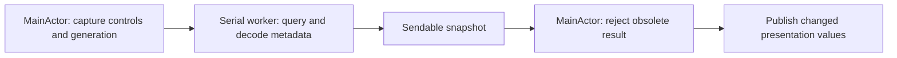

# TrayNook responsiveness: background reads and smaller updates

Researched 2026-11-01 against build 29, the local macOS 26.2 SDK, and Apple/Swift primary sources. The original findings are preserved below; the first four recommendations were implemented on 2026-11-02 for build 32.

## Implementation status: build 32

- [LoginItemStatus](../Sources/TrayNook/LoginItemStatus.swift) replaces per-inventory login-status queries with initialization, General-tab/Settings-activation refreshes, and actual-state refresh after successful or failed changes.
- [WindowMetadataReader](../Sources/TrayNook/WindowMetadataReader.swift) queries known window IDs, decodes immutable `Sendable` metadata on a serial utility queue, and bounds work to one running and one replaceable pending request. Replaced, cancelled, and stopped requests complete without waiting for a blocked C call.
- [NativeMenuBarController](../Sources/TrayNook/NativeMenuBarController.swift) captures AppKit controls/screens on main and rejects observations with obsolete control/display/concealment/operation state or changed source window IDs/PIDs. Native actions retain fresh synchronous checks. [AppModel](../Sources/TrayNook/AppModel.swift) additionally rejects old inventory revisions, edits, Reveal, changed permission, shutdown, and snapshots older than three seconds; it rechecks Accessibility before publication.
- [ApplicationIconCache](../Sources/TrayNook/ApplicationIconCache.swift) shares application URL/images by bundle and system images by symbol. Application ownership, launch/termination, volume changes, Settings entry/activation, and explicit Refresh invalidate relevant entries. Missing applications retry after a two-second lookup backoff.

The updated [scroll benchmark](../Tests/TrayNookTests/ScrollPerformanceTests.swift) scrolls concurrently with real asynchronous inspection. Worker wait time is measured separately from synchronous UI work; a two-millisecond main-actor heartbeat also captures stalls between scroll steps. The 30-row run accepted both background polls: median/p95 synchronous work **2.42/6.31 ms**, warmed maximum **40.83 ms**, warmed heartbeat gap **51.78 ms**, and end-to-end poll latency **60.82 ms**. Cold-inclusive heartbeat reached **101.82 ms**. Both 100 ms warmed guards pass; these figures do not establish an 8/17 ms worst-case frame guarantee.

The standard suite, delayed-result model tests, native seed/owner validation, cache/login tests, and existing recovery/placement/reorder checks pass. Manual native harnesses include the new reader and compile independently. Signed build 32 passed packaged smoke; live readback on two displays found nine hidden-source owners and zero visible hidden-source windows. Repeated incomplete Accessibility scans caused a temporary safe reveal, followed by automatic recovery. The later idle profile shows metadata on the worker queue without repeated login/icon lookup or sustained redraw work; an earlier busy rendering burst remains unclassified. Priority 5 below remains a separate conditional capture/pixel-analysis improvement; ScreenCaptureKit migration and broader device verification are outside this implementation.

## Recommendation

Yes: a serial background reader can produce immutable snapshots and publish small updates on `MainActor`. First remove avoidable work and narrow expensive reads. Moving the entire native controller into a background task would cross AppKit state and weaken its live-action checks.

The next bounded change should remove the login-item status lookup from every inventory scan. Refresh that setting at launch, when General opens or the app becomes active, and after changing it. Then benchmark querying only TrayNook's known control windows and caching application icons. These changes can reduce work without introducing asynchronous staleness. Use the worker design below for the remaining blocking reads if measurement still justifies it.

The present 100 ms scroll regression is a hang guard, not a smooth-scrolling target. Apple recommends keeping continuous-interaction main-thread work below one display interval, approximately 8 or 17 ms; an 88 ms update can still skip frames. [Apple responsiveness guidance](https://developer.apple.com/documentation/xcode/improving-app-responsiveness)

## What remains in the current path

The AX inventory already runs in `Task.detached(priority: .utility)` at [AppModel.swift:281](../Sources/TrayNook/AppModel.swift#L281). On return, `accept` still synchronously checks login status and Screen Recording, inspects native geometry, refreshes proxy images, and publishes presentation state at [AppModel.swift:303](../Sources/TrayNook/AppModel.swift#L303).

The existing build 29 live sample contains 79 samples under `SMAppService.status` and 25 under `native.inspect`, as sibling branches below the same 107-sample refresh subtree. These are sampled stacks, not per-call durations; nested sample counts must not be summed or converted into an exact speedup. The profile also still contains application icon lookup/loading in view rendering. Evidence artifacts: `/private/tmp/traynook-scroll-after.sample.txt` and the build 29 measurements in [HANDOFF.md](HANDOFF.md).

| Priority | Change and evidence | Estimated implementation plus focused checks | Required verification |
| --- | --- | --- | --- |
| 1 | Remove login-status lookup from the 3-second inventory path. The initial value already exists, and `setLoginEnabled` reads the actual result. Leave permission checks unchanged until their cost is measured. Sources: [AppModel.swift:37](../Sources/TrayNook/AppModel.swift#L37), [307](../Sources/TrayNook/AppModel.swift#L307), [960](../Sources/TrayNook/AppModel.swift#L960). | 1–2 hours | External System Settings changes appear when General is opened/activated; registration failure and requires-approval feedback stay accurate. Profile `accept` again. |
| 2 | Query known TrayNook control window IDs instead of creating dictionaries for every window and discarding almost all of them. `environment()` gathers its status IDs before calling `.optionAll`; the isolated targeted-read probe measured a much cheaper query while retaining the expanded separator. Sources: [NativeMenuBarController.swift:1573](../Sources/TrayNook/NativeMenuBarController.swift#L1573), [targeted query contract](https://developer.apple.com/documentation/coregraphics/cgwindowlistcreatedescriptionfromarray(_:)). | 2–4 hours | Preserve offscreen expanded separators and all mirrored controls; missing/recreated IDs fail safely. Compare metadata and timing with the current query. |
| 3 | Cache application URL/icon results by bundle identity; invalidate on app/path changes and avoid permanently caching a missing application. `icon(for:)` performs workspace calls from each preview/detail body. Sources: [AppModel.swift:150](../Sources/TrayNook/AppModel.swift#L150), [Views.swift:306](../Sources/TrayNook/Views.swift#L306), [LayoutPreviewView.swift:163](../Sources/TrayNook/LayoutPreviewView.swift#L163). | 2–4 hours | First use, relaunch, missing/reinstalled app, sibling items, and system-symbol fallbacks remain correct. Warm row redraws make no workspace lookup. |
| 4 | Extract remaining blocking window metadata reads and decoding to one serial worker. Main captures UI/control values; worker returns a `Sendable` snapshot; main compares and publishes. | 1–2 days | Outdated results never overwrite Reveal, edits, permission changes, display switches, process replacement, or a newer scan. Bound pending work and measure UI latency, not only query runtime. |
| 5 | Reduce optional glyph work, then move its pixel analysis off-main. The open Dropdown currently refreshes every second even when app icons are selected, and `accept` refreshes proxy images too. Sources: [Views.swift:404](../Sources/TrayNook/Views.swift#L404), [AppModel.swift:187](../Sources/TrayNook/AppModel.swift#L187), [ProxyImageCapture.swift:33](../Sources/TrayNook/ProxyImageCapture.swift#L33). | 4–8 hours for gating/analysis; capture migration is separate | Preserve the last useful image before a source is concealed, permission revocation, capture fallback, and exclusion during native operations. This path was not established as the idle profile's principal cost. |

## Which work can leave the main thread?

| Work | Verified contract and practical restriction |
| --- | --- |
| AppKit controls and current geometry seed | Keep `NSStatusItem`/button/window access, `NSApp.windows`, and UI publication on main. `environment()` mixes these with CoreGraphics at [NativeMenuBarController.swift:1558](../Sources/TrayNook/NativeMenuBarController.swift#L1558). Apple's threading guide requires main-thread use of views; the local SDK/compiler also diagnoses off-main `NSApplication.shared.windows`. Capture screen/frame numbers as values, rather than sending live AppKit objects to a worker. This is not a claim that every `NSScreen` getter is documented main-only. [Thread Safety Summary](https://developer.apple.com/library/archive/documentation/Cocoa/Conceptual/Multithreading/ThreadSafetySummary/ThreadSafetySummary.html) |
| Window metadata | Apple explicitly calls `CGWindowListCopyWindowInfo` dictionary generation relatively expensive. It has no main-actor annotation in the inspected SDK, and the isolated worker probe succeeds. No explicit per-function arbitrary-thread guarantee was found in the fetched documentation. Treat the worker as a candidate requiring runtime validation on supported releases, rather than presenting absent annotations as proof. [CopyWindowInfo](https://developer.apple.com/documentation/coregraphics/cgwindowlistcopywindowinfo(_:_:)) |
| Application icons | Apple explicitly states `NSWorkspace.icon(forFile:)` can be called safely from any app thread. The archived image guide permits creating an `NSImage` on one thread and handing it to main. Avoid concurrent mutation and satisfy Swift `Sendable`/ownership rules; caching on main is an easier first improvement. No equally explicit thread statement was located for `urlForApplication(withBundleIdentifier:)`. [Icon method](https://developer.apple.com/documentation/appkit/nsworkspace/icon(forfile:)), [image threading restrictions](https://developer.apple.com/library/archive/documentation/Cocoa/Conceptual/Multithreading/ThreadSafetySummary/ThreadSafetySummary.html) |
| Login/permission state | `SMAppService.status` and `CGPreflightScreenCaptureAccess` are synchronous reads with no explicit thread guarantee found in their inspected docs/headers. Prefer reducing refresh frequency before moving them. Keep permission prompts and resulting UI transitions on main. Refresh on app activation/Permissions entry and explicit permission flow, while retaining existing native-action permission checks. [SMAppService.status](https://developer.apple.com/documentation/servicemanagement/smappservice/status-swift.property); SDK `SMAppService.h:234–248`, `CGWindow.h:294–298`. |
| Capture and pixel analysis | RGBA conversion and glyph luminance/colour analysis operate on image bytes and are natural worker work. `CGWindowListCreateImage` is obsolete/deprecated in the inspected SDK; Apple provides asynchronous screenshot capture in ScreenCaptureKit. That is a separate compatibility change, not evidence that capture of concealed windows will begin working. [SCScreenshotManager](https://developer.apple.com/documentation/screencapturekit/scscreenshotmanager), SDK `CGWindow.h:271–283`. |

`CGWindowListCreateDescriptionFromArray` is a public targeted alternative. Its result can omit closed window IDs, and dictionaries must be matched by `kCGWindowNumber`, not array position or count. The currently Swift-unavailable `CGWindowListCreate` cannot simply supply its input; any Swift construction of the raw window-ID CFArray must be verified. Keep all current identity, mirror, geometry, and missing-window validation. [Apple contract](https://developer.apple.com/documentation/coregraphics/cgwindowlistcreatedescriptionfromarray(_:)); SDK `CGWindow.h:174–194`.

## A small worker module

One module should own the blocking read, coalescing, decoding, and result lifetime. A useful interface is a single asynchronous `read(request) -> snapshot` seam, with an internal fake reader for delayed/error cases. It does not need a general event bus or a custom actor executor to start.



Use a dedicated serial `DispatchQueue` with an async continuation around its synchronous read. A plain actor serializes its methods but does not, by itself, promise a dedicated blocking thread. A custom executor is an option only if its extra control becomes necessary. GCD's non-main queues run on system-managed threads and preserve serial submission order; Swift custom executors exist when stronger executor control is needed. [DispatchQueue](https://developer.apple.com/documentation/dispatch/dispatchqueue), [SE-0392](https://github.com/swiftlang/swift-evolution/blob/main/proposals/0392-custom-actor-executors.md)

Bound the workload to one in-flight read plus one replaceable latest request. GCD queues are FIFO: merely enqueueing every poll creates a backlog of obsolete snapshots. An actor around scheduling state or a small main-owned scheduler can coalesce requests; an unbounded `AsyncStream` or a task per item would recreate the problem.

The snapshot should contain plain immutable values such as window ID, PID, frame, visibility, capture time, and the request generation. Decode `CFArray`/`[[String: Any]]` on the worker; do not transfer that untyped object graph or mutable AppKit controls across executors. The project already has `Sendable` source models and `ItemFrame` in [Models.swift:3](../Prototypes/InventoryIdentitySpike/Sources/InventoryIdentityCore/Models.swift#L3).

Reject completion if its scan/request generation or the display, control-window identity, layout revision, permission state, reveal generation, or native-operation state no longer matches. An age limit is additional protection, not a replacement for those checks. A slow read must neither overwrite a newer layout nor conceal something the user just revealed. A cancelled Swift task does not forcibly interrupt a synchronous C/IPC call; release its result when it returns. [SE-0304 cancellation](https://github.com/swiftlang/swift-evolution/blob/main/proposals/0304-structured-concurrency.md#cancellation)

Start with observational/presentation reads. Native moves and activations must continue to validate fresh identity, PID, geometry, permission, and input state immediately before acting; a display cache is not authorization to post input. Existing reference points are `stableTarget`, `freshInventory`, and the native generation check in `NativeMenuBarController.swift`.

## Swift concurrency details that affect the design

`Task { ... }` created inside `@MainActor` inherits that actor. Adding a task or marking a method `async` does not make its synchronous work background work. The existing detached AX scan deliberately escapes this context. [SE-0304 task context](https://github.com/swiftlang/swift-evolution/blob/main/proposals/0304-structured-concurrency.md#context-inheritance)

The project uses Swift tools version 6.0 and Swift 6 language mode, a minimum macOS 14 target, and no explicit default actor-isolation/upcoming-feature setting in [Package.swift](../Package.swift). This machine's compiler is Swift 6.2.3. Nonisolated-async execution semantics are affected by SE-0338 and the newer opt-in `NonisolatedNonsendingByDefault` behaviour of SE-0461, so do not rely on a vague “async means background” rule. An explicit queue makes the location of the blocking call unambiguous. [SE-0338](https://github.com/swiftlang/swift-evolution/blob/main/proposals/0338-clarify-execution-non-actor-async.md), [SE-0461](https://github.com/swiftlang/swift-evolution/blob/main/proposals/0461-async-function-isolation.md)

Avoid waiting synchronously on an async result, semaphore, or main-queue `sync` from the worker. Main should await completion, remain available to input, and apply one coherent changed snapshot when the result is still current.

## Experiments and acceptance criteria

An isolated, read-only Swift 6 probe compared 30 main-thread metadata queries with 30 queries on a serial utility queue, while a 2 ms MainActor heartbeat measured scheduling gaps. For 541 windows: main-query median/max were 12.69/16.68 ms and worst heartbeat gap 18.72 ms; worker-query median/max were 7.83/14.71 ms and heartbeat gap 6.83 ms. The probe also reported `Task` inheritance on main and detached work off-main. Source: local ignored `.build/research/background-query-probe.swift`.

This single experiment demonstrates typechecked/runtime feasibility and improved heartbeat in that probe. Cache warmth and scheduling differ between cases; it does not establish an official thread guarantee, an expected production speedup, or smooth scrolling at 120 Hz.

A second read-only Swift 6 probe compared 30 full-list reads with 30 targeted reads on main. Full-list metadata for 540 windows took a median 6.22 ms and maximum 8.08 ms; metadata for three known TrayNook status windows took a median 0.13 ms and maximum 2.89 ms. All three requested IDs were returned, including the expanded boundary. The prototype builds the CFArray from raw `CGWindowID` bit patterns with null callbacks, rather than an NSNumber array. Source: local ignored `.build/research/targeted-window-query-probe.swift`. This is roughly 47 times less median query time in one run, not a 47-times faster UI. Production must still verify all mirrored IDs, missing windows, and metadata parity; its existing `NSApp` status-window IDs remove the probe's initial full-list discovery step.

The prototype sources/binaries remain local research artifacts under ignored `.build/research`, rather than shipped code. Their current binaries can be rerun in the GUI session with:

```sh
.build/research/background-query-probe
.build/research/targeted-window-query-probe
```

For a production candidate, rerun `TRAYNOOK_SCROLL_BENCHMARK=1 Scripts/test.sh --filter ScrollPerformanceTests` with TrayNook quit. Record median, p95, warmed maximum, and cold-inclusive maximum; keep the existing 100 ms hang guard while measuring 8/17 ms frame budgets separately. Add a main-thread heartbeat because the current benchmark measures synchronous scroll/layout work and could miss unrelated asynchronously delivered stalls. [Benchmark source](../Tests/TrayNookTests/ScrollPerformanceTests.swift#L77)

Exercise deliberately delayed and out-of-order completions, explicit Reveal, layout edits during reads, process/window replacement, permission loss, sleep/display changes, queue shutdown, and callback failure. Assert at most one running read and one pending request, no stale UI commit, no native input based on worker presentation, and no leak of a cancelled request. Retain the existing recovery, reorder, placement, smoke, and two-display native checks.

The unresolved evidence is the exact production gain from removing each residual path, API-specific worker behaviour across supported macOS versions, and cold/crowded/multiple-display behaviour after a worker split. No new responsiveness guarantee is claimed until those checks run.
